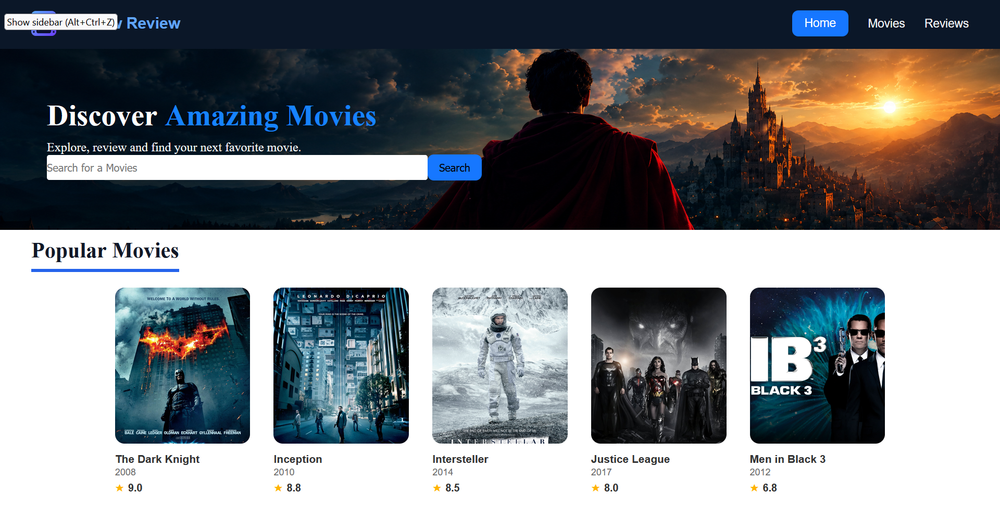
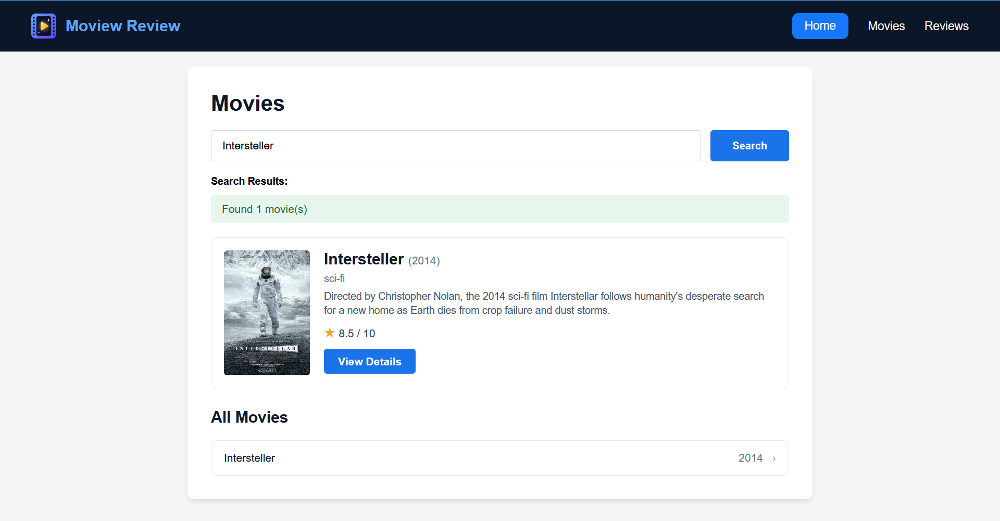
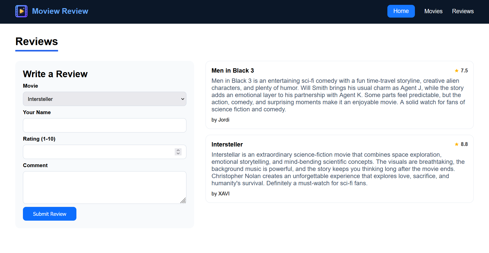

# BST Movie Review System

A simple movie review web application built using Django and Python.

## Features

- View movies and movie details
- Search movies
- Browse movie genres
- Read and manage reviews
- Binary Search Tree (BST) implementation

## Technologies

- Python
- Django
- HTML, CSS, JavaScript
- SQLite
- Binary Search Tree

## Screenshots







## Run Locally

```bash
cd myproject
python -m pip install django
python manage.py migrate
python manage.py runserver
```

Open `http://127.0.0.1:8000/` in your browser.

## GitHub

https://github.com/stochos-vajra/BST-Movie-Review-System
